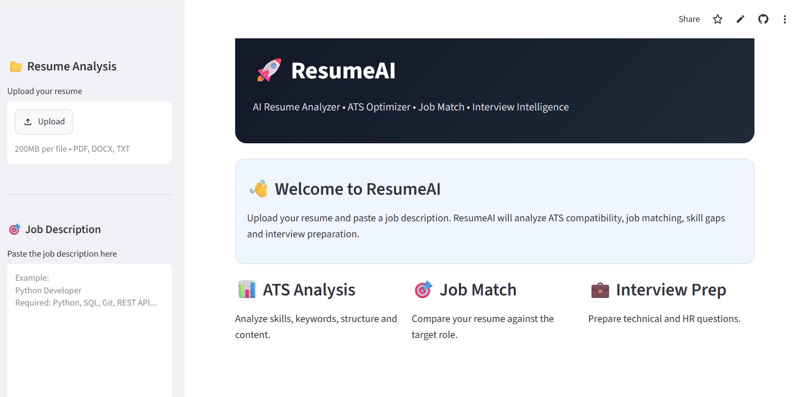
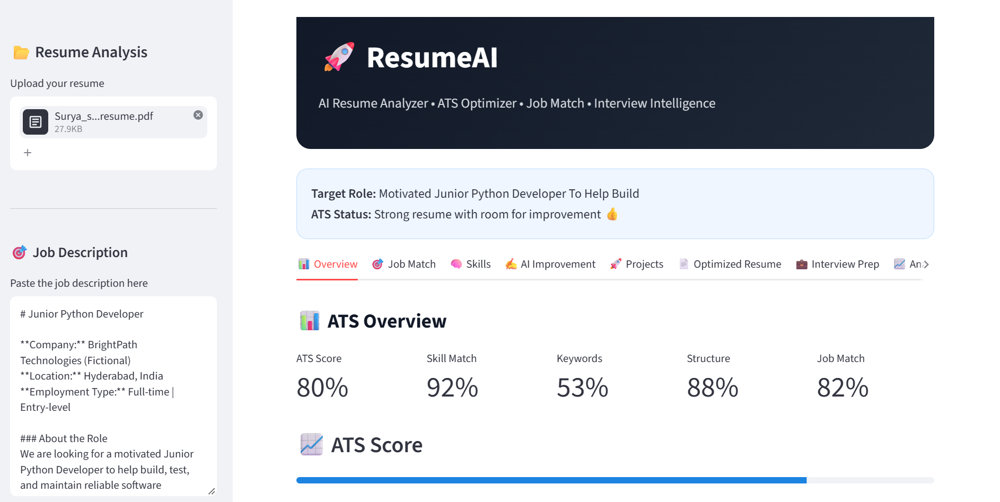
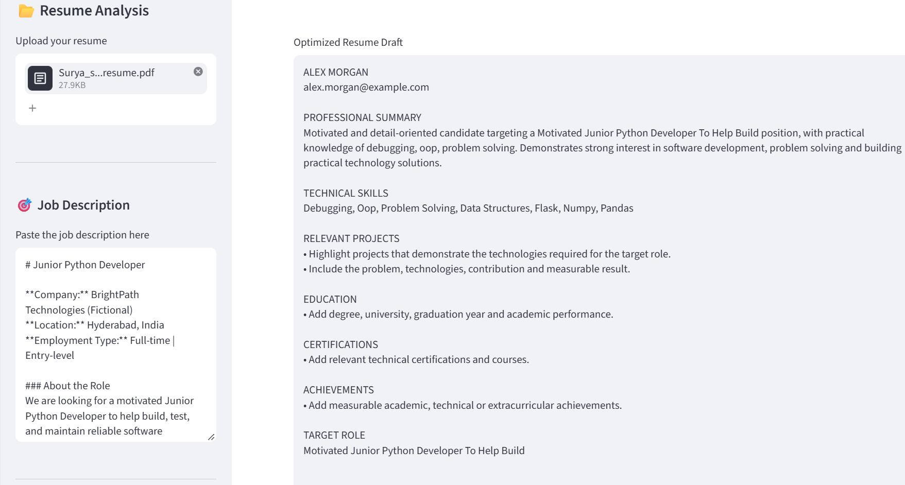

# ResumeAI: AI Resume Analyzer & ATS Optimizer

A Streamlit app that compares a resume against a job description and gives ATS-style match scores, skill and keyword gaps, and suggestions for improvement.

**[Live Demo](https://resumeai-qguuz9q9cuccuw2kwhpyfy.streamlit.app/)**

> **Note:** ResumeAI uses rule-based text matching and heuristics. Scores are estimates. They are not real employer ATS scores and do not predict hiring outcomes.

## Screenshots





## Features

- Upload a resume in PDF or DOCX format and view the extracted text
- Compare detected skills and keywords against a pasted job description
- ATS-style scores for job match, skills, keywords, structure, and content
- Matched and missing skills/keywords, strengths, and improvement suggestions
- Suggested professional summary and an optimized resume draft
- Project ideas, interview questions, and a preparation plan
- Download the analysis as a PDF report
- Input validation for empty job descriptions and unsupported file types

## Tech Stack

Python, Streamlit

## Run Locally

```bash
git clone https://github.com/hasinibavirisetty15-cpu/ResumeAI.git
cd ResumeAI
python -m venv .venv
# Windows: .\.venv\Scripts\Activate.ps1
# macOS/Linux: source .venv/bin/activate
python -m pip install -r requirements.txt
python -m streamlit run resume_analyzer.py
```

Then open `http://localhost:8501`.

## How to Use

1. Upload a text-based PDF or DOCX resume.
2. Paste the target job description.
3. Click **Analyze Resume** and review the results.
4. Download the PDF report if needed.

Scanned or image-only PDFs may not work because no text can be extracted.

## Run Tests

```bash
python -m unittest discover tests
```

## Privacy

The app is not designed to save uploaded resumes to a database. Avoid uploading sensitive documents, and use resumes only with the owner's permission.

## Future Work

- Better keyword matching for synonyms and related phrases
- OCR support for scanned PDFs
